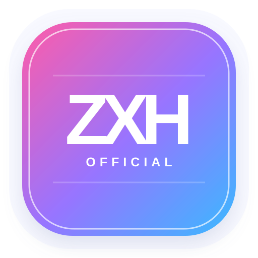
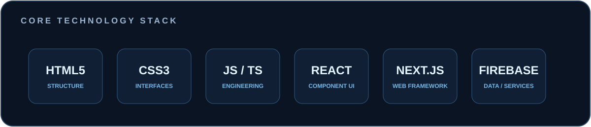
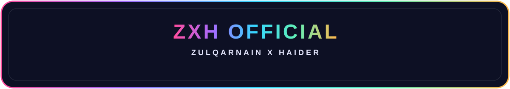

 

# 𝐙𝐗𝐇 ＯＦＦＩＣＩＡＬ

### 𝐙𝐔𝐋𝐐𝐀𝐑𝐍𝐀𝐈𝐍 𝐗 𝐇𝐀𝐈𝐃𝐄𝐑

**INDEPENDENT DEVELOPER&nbsp; · &nbsp;DIGITAL CREATOR&nbsp; · &nbsp;PRODUCT BUILDER**

 

  

 

&nbsp;

&nbsp;

 

## THE BUILDER BEHIND ZXH

I'm **Zulqarnain X Haider**, the creator behind **ZXH OFFICIAL** — an independent development brand built around useful digital products, modern web experiences and continuous experimentation.

I enjoy turning ideas into working products: from clean user interfaces and browser-based tools to APIs and installable web applications.

- ◈ **BUILDING** — Web apps, PWAs, APIs and developer utilities.
- ◈ **EXPLORING** — Frontend engineering, backend integrations and automation.
- ◈ **PRIORITIZING** — Usability, responsive design, performance and clean implementation.
- ◈ **IDENTITY** — ZXH OFFICIAL.

 

---

## TOOLS OF THE TRADE

*The technologies and platforms I work with and explore.*

 

  

  

---

## THE PROJECT ARCHIVE

*Selected builds from the ZXH OFFICIAL ecosystem.*

<table>
<tr>
<td width="50%" valign="top">

### ◈ ZXH OFFICIAL TOOLS

A collection of browser-based utilities designed to make everyday digital tasks easier.

</td>
<td width="50%" valign="top">

### ◈ ZXH MOVIES HUB

A movie and TV discovery experience with a multi-server playback interface.

</td>
</tr>
<tr>
<td width="50%" valign="top">

### ◈ ZXH OFFICIAL COMPANY

A dedicated brand and company web experience.

</td>
<td width="50%" valign="top">

### ◈ ZXH WEB SCRAPPER

A web-scraping focused development project.

</td>
</tr>
<tr>
<td width="50%" valign="top">

### ◈ ZXH MDFIRE DOWNLOADER

A media downloader web project.

</td>
<td width="50%" valign="top">

### ◈ ZXH OFFICIAL API

An API project powering integrations across the ZXH ecosystem.

</td>
</tr>
<tr>
<td width="50%" valign="top">

### ◈ ZXH OFFICIAL HOSTING

Hosting-related project and experiments.

</td>
<td width="50%" valign="top">

### ◈ ZXH WP DP FETCHER

A WordPress profile-picture fetching utility.

</td>
</tr>
</table>

---

## ACTIVITY & ANALYTICS

 

  

  

Analytics are provided by external services and may occasionally be delayed or unavailable.

---

## FIND ME AROUND THE WEB

 

 

  

### BUILD WITH PURPOSE. CREATE WITH IDENTITY.

**CREATED & DEVELOPED BY**

# 𝐙𝐔𝐋𝐐𝐀𝐑𝐍𝐀𝐈𝐍 ✦ 𝐗 ✦ 𝐇𝐀𝐈𝐃𝐄𝐑

**POWERED BY 𝐙𝐗𝐇 𝐎𝐅𝐅𝐈𝐂𝐈𝐀𝐋**

© ZXH OFFICIAL · ALL RIGHTS RESERVED

