  

# 𝐙𝐗𝐇 𝐎𝐅𝐅𝐈𝐂𝐈𝐀𝐋

### 𝐙𝐔𝐋𝐐𝐀𝐑𝐍𝐀𝐈𝐍 𝐗 𝐇𝐀𝐈𝐃𝐄𝐑

**INDEPENDENT DEVELOPER · DIGITAL CREATOR · PRODUCT BUILDER**

  
  
  

  
  
  

---

## 𓆩 01 / THE DEVELOPER 𓆪

I'm **Zulqarnain X Haider**, creator of **ZXH OFFICIAL** — an independent development brand focused on building useful digital products and modern web experiences.

I work across the web development stack, turning ideas into practical tools, interfaces, APIs and installable web experiences. My approach is product-first: keep the experience clear, make the functionality useful, and keep improving the implementation.

- **Building:** web applications, developer utilities, APIs and Progressive Web Apps.
- **Exploring:** modern frontend architecture, backend integrations and automation.
- **Focused on:** responsive interfaces, performance, maintainable code and real-world usability.
- **Brand:** ZXH OFFICIAL.
- **Creator:** Zulqarnain X Haider.

 

---

## 𓆩 02 / TECHNOLOGY UNIVERSE 𓆪

### Languages & Frameworks

### Platforms & Developer Tools

---

## 𓆩 03 / SELECTED PROJECTS 𓆪

| PROJECT | WHAT IT IS | ACCESS |
|:--|:--|:--|
| **ZXH Official Tools** | A browser-based collection of practical online utilities. | [Live website](https://zxh-official-tools.pages.dev/) · [Source code](https://github.com/zulqarnainhaider7116-art/ZXH-Official-Tools) |
| **ZXH Movies Hub** | Movie and TV discovery / streaming interface project. | [GitHub repository](https://github.com/zulqarnainhaider7116-art/ZXH-OFFICIAL-MOVIES-HUB) |
| **ZXH Official Company** | Company and brand web experience. | [GitHub repository](https://github.com/zulqarnainhaider7116-art/ZXH-OFFICIAL-COMPANY) |
| **ZXH Web Scrapper** | Web-scraping focused development project. | [GitHub repository](https://github.com/zulqarnainhaider7116-art/zxh-official-web-scrapper) |
| **ZXH MDFire Downloader** | Media downloader web project. | [Live website](https://zxh-official-mdfire-dl.vercel.app/) · [Source code](https://github.com/zulqarnainhaider7116-art/zxh-official-mdfire-dl) |
| **ZXH Official API** | API project for ZXH integrations. | [GitHub repository](https://github.com/zulqarnainhaider7116-art/zxh-official-api) |
| **ZXH Official Hosting** | Hosting-related project and experiments. | [GitHub repository](https://github.com/zulqarnainhaider7116-art/zxh-official-hosting) |
| **ZXH WP DP Fetcher** | WordPress profile-picture fetching utility. | [GitHub repository](https://github.com/zulqarnainhaider7116-art/ZXH-OFFICIAL-WP-DP-FETCHER-) |

  <a href="https://github.com/zulqarnainhaider7116-art?tab=repositories"><b>↗ EXPLORE ALL PUBLIC REPOSITORIES</b></a>

---

## 𓆩 04 / GITHUB ANALYTICS 𓆪

 

 

Note: GitHub analytics images are generated by external services and may occasionally be unavailable or delayed.

---

## 𓆩 05 / CONNECT & FOLLOW 𓆪

---

## 𓆩 06 / THE ZXH PRINCIPLE 𓆪

> **Build with purpose. Design with clarity. Ship with confidence.**
>
> Every project is an opportunity to learn, improve and create something genuinely useful.

**CREATED & DEVELOPED BY**

# 𝐙𝐔𝐋𝐐𝐀𝐑𝐍𝐀𝐈𝐍 ✦ 𝐗 ✦ 𝐇𝐀𝐈𝐃𝐄𝐑

**Powered by 𝐙𝐗𝐇 𝐎𝐅𝐅𝐈𝐂𝐈𝐀𝐋**

© ZXH OFFICIAL · Designed for builders, dreamers and makers.

